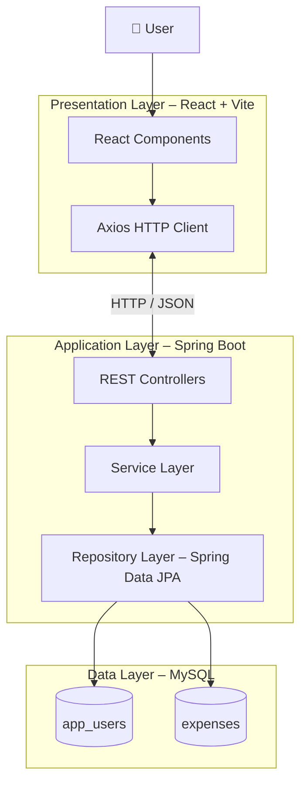

# 💰 SpendWise – Smart Personal Expense Tracker

\<p align="center">
&#x20; \
\</p>

\<p align="center">
&#x20; \<strong>A modern full-stack web application for managing personal income, expenses and financial activities.\</strong>
\</p>

\<p align="center">
&#x20; \
&#x20; \
&#x20; \
&#x20; \
&#x20; \
\</p>

\<p align="center">
&#x20; \<a href="#-overview">Overview\</a> •
&#x20; \<a href="#-features">Features\</a> •
&#x20; \<a href="#-technology-stack">Tech Stack\</a> •
&#x20; \<a href="#-architecture">Architecture\</a> •
&#x20; \<a href="#-installation--setup">Installation\</a> •
&#x20; \<a href="#-api-documentation">APIs\</a>
\</p>

---

## 📌 Overview

**SpendWise** is a full-stack Personal Expense Tracker developed to make everyday financial management easier, more organized and understandable.

The application provides a centralized platform where users can record income and expenses, manage financial transactions and understand their spending activities.

Built using **React.js, Java 21, Spring Boot and MySQL**, SpendWise demonstrates how modern frontend and backend technologies work together to create a complete web application.

### 🎯 Project Objectives

- Simplify daily income and expense tracking.
- Maintain organized financial transaction records.
- Provide a centralized financial dashboard.
- Analyze income and expense activities.
- Identify unusually high expenses.
- Display recurring expense information.
- Generate printable financial reports.

## ✨ Features

| Feature                | Description                                                  |
| ---------------------- | ------------------------------------------------------------ |
| 📊 Dashboard           | Overview of income, expenses and available balance.          |
| 💵 Income Management   | Record and manage income transactions.                       |
| 💳 Expense Management  | Add, edit and delete expense records.                        |
| 📅 Daily Expenses      | View transactions by date.                                   |
| 🗓️ Monthly Expenses   | Understand monthly spending activities.                      |
| 📈 Analytics           | Visualize financial information through charts.              |
| 🚨 High Expense Alerts | Highlight expenses exceeding configured thresholds.          |
| ⚠️ High-Value Payments | Review transactions with unusually high amounts.             |
| 🔁 Recurring Payments  | View repeated expense patterns and schedules.                |
| 📄 Financial Reports   | Prepare printable financial summaries and PDF-ready reports. |

> **Note:** High-expense and high-value payment indicators are rule-based review features, not verified bank fraud detection. Recurring payment information is displayed for tracking; the application does not automatically process payments.

## 🛠️ Technology Stack

The project uses separate frontend and backend development environments.

### Frontend

\<p>
&#x20; \
\</p>

| Technology | Purpose                        |
| ---------- | ------------------------------ |
| React.js   | Component-based user interface |
| JavaScript | Frontend application logic     |
| HTML5      | Webpage structure              |
| CSS3       | Styling and responsive layouts |
| Vite       | Frontend development server    |
| Axios      | HTTP requests to backend APIs  |

### Backend

\<p>
&#x20; \
\</p>

| Technology      | Purpose                                    |
| --------------- | ------------------------------------------ |
| Java 21         | Backend programming language               |
| Spring Boot     | Backend application framework              |
| Spring Data JPA | Database access and persistence            |
| REST APIs       | Communication between frontend and backend |
| Maven           | Dependency and build management            |

### Database

\<p>
&#x20; \
\</p>

| Technology | Purpose                           |
| ---------- | --------------------------------- |
| MySQL 8+   | Relational database               |
| Hibernate  | ORM and database table management |

### Development Tools

\<p>
&#x20; \
\</p>

- Visual Studio Code – Frontend development.
- Eclipse IDE – Java and Spring Boot development.
- Postman – REST API testing.
- Git – Version control.
- GitHub – Source code hosting.

---

## 🏗️ Architecture

SpendWise follows a three-tier architecture that separates the user interface, application logic and database.



### 🔄 How the Application Works

1. The user interacts with the React frontend.
2. Axios sends HTTP requests to the Spring Boot backend.
3. REST controllers receive and process incoming requests.
4. The service layer handles application logic.
5. Spring Data JPA communicates with MySQL through repositories.
6. The backend returns responses to the frontend.
7. React updates the interface with the returned information.

### 🌐 Local Development Ports

| Component           | Address                 |
| ------------------- | ----------------------- |
| React Frontend      | `http://localhost:5173` |
| Spring Boot Backend | `http://localhost:8080` |
| MySQL Database      | `localhost:3306`        |

---

## 📂 Project Structure

```text
SpendWise/
│
├── backend/
│   ├── src/
│   │   └── main/
│   │       ├── java/
│   │       │   └── com/expense/tracker/
│   │       │       ├── controller/
│   │       │       ├── entity/
│   │       │       ├── repository/
│   │       │       ├── service/
│   │       │       └── ExpenseTrackerApplication.java
│   │       │
│   │       └── resources/
│   │           └── application.properties
│   │
│   └── pom.xml
│
├── frontend/
│   ├── src/
│   │   ├── components/
│   │   ├── pages/
│   │   ├── services/
│   │   └── App.jsx
│   │
│   ├── public/
│   ├── index.html
│   ├── package.json
│   └── vite.config.js
│
├── sqldb/
│   └── schema.sql
│
└── README.md
```

---

## ⚙️ Installation & Setup

Follow these instructions to run SpendWise on your local machine.

### 📋 Prerequisites

Make sure the following software is installed:

| Software           | Required Version               |
| ------------------ | ------------------------------ |
| Java JDK           | 21                             |
| Maven              | 3.8+ or Eclipse embedded Maven |
| Node.js            | 20+                            |
| npm                | Included with Node.js          |
| MySQL              | 8.0+                           |
| Eclipse IDE        | Spring Boot development        |
| Visual Studio Code | React development              |

### 1️⃣ Clone the Repository

Open your terminal and execute:

```bash
git clone https://github.com/aadeshkhamkar/SpendWise.git
```

Navigate into the project:

```bash
cd SpendWise
```

### 2️⃣ Configure MySQL Database

Open MySQL Workbench or MySQL Command Line.

Execute the SQL file:

```text
sqldb/schema.sql
```

Alternatively, use:

```sql
SOURCE /path/to/SpendWise/sqldb/schema.sql;
```

The backend expects the following configuration:

| Setting  | Value               |
| -------- | ------------------- |
| Database | `expense_tracker`   |
| Username | `root`              |
| Password | Your MySQL password |
| Port     | `3306`              |

Open:

```text
backend/src/main/resources/application.properties
```

Update your database password:

```properties
spring.datasource.url=jdbc:mysql://localhost:3306/expense_tracker
spring.datasource.username=root
spring.datasource.password=YOUR_MYSQL_PASSWORD
```

**Important:** Replace the password with your local MySQL password. Never upload real database credentials to GitHub.

### 3️⃣ Run the Backend – Eclipse IDE

1. Open Eclipse IDE.
2. Select **File → Import**.
3. Select **Maven → Existing Maven Projects**.
4. Browse to the SpendWise `backend` folder.
5. Click Finish.
6. Wait for Maven dependencies to download.
7. Open `ExpenseTrackerApplication.java`.
8. Right-click and select **Run As → Spring Boot App**.

The backend should start at:

```text
http://localhost:8080
```

Test the backend using:

```http
GET http://localhost:8080/api/expenses
```

### 4️⃣ Run the Frontend – VS Code

Open the `frontend` folder in Visual Studio Code.

Open the integrated terminal and execute:

```bash
npm install
```

Start the React development server:

```bash
npm run dev
```

Open the URL displayed by Vite:

```text
http://localhost:5173
```

### 5️⃣ Run Both Applications Together

Keep both applications running:

| Application | Development Environment | Port |
| ----------- | ----------------------- | ---- |
| Frontend    | VS Code / Vite          | 5173 |
| Backend     | Eclipse / Spring Boot   | 8080 |
| Database    | MySQL                   | 3306 |

The React frontend communicates with Spring Boot through Axios and REST APIs.

---

## 🔌 API Documentation

The backend exposes REST endpoints to manage income and expense transactions.

**Base URL:**

```text
http://localhost:8080/api
```

### Available Endpoints

| HTTP Method | Endpoint         | Description                    |
| ----------- | ---------------- | ------------------------------ |
| GET         | `/expenses`      | Retrieve all transactions      |
| GET         | `/expenses/{id}` | Retrieve a transaction by ID   |
| POST        | `/expenses`      | Create a new transaction       |
| PUT         | `/expenses/{id}` | Update an existing transaction |
| DELETE      | `/expenses/{id}` | Delete a transaction           |

### 📝 Example: Create a Transaction

**Request:**

```http
POST http://localhost:8080/api/expenses
Content-Type: application/json
```

**JSON Body:**

```json
{
  "title": "Monthly Salary",
  "amount": 25000,
  "category": "Salary",
  "type": "INCOME",
  "date": "2026-11-17",
  "description": "November salary"
}
```

### Transaction Types

| Type      | Meaning        |
| --------- | -------------- |
| `INCOME`  | Money received |
| `EXPENSE` | Money spent    |

### Example: Retrieve All Transactions

```http
GET http://localhost:8080/api/expenses
```

### Example: Update a Transaction

```http
PUT http://localhost:8080/api/expenses/1
```

### Example: Delete a Transaction

```http
DELETE http://localhost:8080/api/expenses/1
```

Use Postman to send requests and inspect API responses.

> **Authentication note:** This repository version documents the transaction API provided by the supplied starter project. Login/signup authentication is not included in this documented API set.

---

## 🗄️ Database Design

SpendWise uses MySQL for persistent storage.

### Database Information

```text
Database: expense_tracker
```

Main tables:

| Table       | Description                                                  |
| ----------- | ------------------------------------------------------------ |
| `app_users` | User account information, if included in the database schema |
| `expenses`  | Income and expense transaction records                       |

Hibernate is configured with:

```properties
spring.jpa.hibernate.ddl-auto=update
```

This allows Hibernate to create or update mapped tables automatically.

The SQL schema file is available at:

```text
sqldb/schema.sql
```

---

## 🧪 Testing

The following testing areas are relevant to the project:

| Testing Type        | Purpose                                           |
| ------------------- | ------------------------------------------------- |
| API Testing         | Verify REST API requests and responses            |
| Functional Testing  | Check transaction operations                      |
| Integration Testing | Verify React, Spring Boot and MySQL communication |
| Validation Testing  | Check transaction inputs and data formats         |
| UI Testing          | Verify application pages and user interactions    |

Postman is used for testing backend API endpoints.

Actual test results should be recorded after executing the tests.

---

## 🖥️ Application Screenshots

Add screenshots of your actual running application in the following folder:

```text
docs/screenshots/
```

Suggested screenshots:

| Screenshot          | Suggested Filename    |
| ------------------- | --------------------- |
| Landing Page        | `landing-page.png`    |
| Dashboard           | `dashboard.png`       |
| Add Transaction     | `add-transaction.png` |
| Analytics           | `analytics.png`       |
| Transaction History | `transactions.png`    |
| Reports             | `reports.png`         |

When screenshots are added, display them using:

```markdown

```

---

## 🚀 Future Enhancements

Possible improvements for future versions:

- JWT-based authentication and authorization.
- User-specific transaction access.
- Advanced spending analytics.
- Machine learning-based expense predictions.
- Automated recurring expense reminders.
- Budget planning and savings goals.
- CSV and Excel report exports.
- Cloud deployment.
- Mobile application support.

---

## 🛠️ Troubleshooting

\<details>
\<summary>\<strong>1. MySQL connection error\</strong>\</summary>

- Check whether MySQL Server is running.
- Verify the database name.
- Check the username and password in `application.properties`.
- Confirm that port `3306` is available.

\</details>

\<details>
\<summary>\<strong>2. Backend not starting\</strong>\</summary>

- Check Java version using `java -version`.
- Make sure Java 21 is configured in Eclipse.
- Update Maven dependencies.
- Check the Eclipse console for errors.
- Verify that port `8080` is not occupied.

\</details>

\<details>
\<summary>\<strong>3. Frontend dependency error\</strong>\</summary>

Run:

```bash
npm install
```

If dependency conflicts occur, check the compatibility of Vite and its React plugin versions in `package.json`. Use compatible versions rather than immediately forcing dependency installation.

\</details>

\<details>
\<summary>\<strong>4. Frontend cannot connect to backend\</strong>\</summary>

- Make sure Spring Boot is running.
- Verify the backend URL.
- Check Axios API configuration.
- Confirm that CORS allows `http://localhost:5173`.
- Inspect the browser developer console.

\</details>

\<details>
\<summary>\<strong>5. Port already in use\</strong>\</summary>

Check which application is using ports `8080` or `5173`, then stop that process or configure an available port.

\</details>

---

## 🤝 Contributing

Contributions and suggestions are welcome!

To contribute:

1. Fork this repository.
2. Create a new branch.
3. Make your changes.
4. Test your changes.
5. Submit a Pull Request.

```bash
git checkout -b feature/your-feature
git add .
git commit -m "Add your feature"
git push origin feature/your-feature
```

---

## 👨‍💻 Project Information

**Project:** SpendWise – Smart Personal Expense Tracker

**Developed By:** Aadesh Khamkar

**Institution:** Dr. D. Y. Patil Institute of Engineering, Management and Research, Akurdi, Pune.

**Training Organization:** ExcelR

**Domain:** Full Stack Web Development

**Repository:** [github.com/aadeshkhamkar/SpendWise](https://github.com/aadeshkhamkar/SpendWise)

---

## 📚 References

- [React Documentation](https://react.dev/)
- [Spring Boot Documentation](https://docs.spring.io/spring-boot/)
- [Java Documentation](https://docs.oracle.com/en/java/)
- [MySQL Documentation](https://dev.mysql.com/doc/)
- [Axios Documentation](https://axios-http.com/docs/intro)
- [Vite Documentation](https://vite.dev/guide/)

---

\<p align="center">   \   \<strong>SpendWise – Track Smarter. Spend Better.\</strong>   \<br/>   Made with ❤️ by Aadesh Khamkar \</p>
