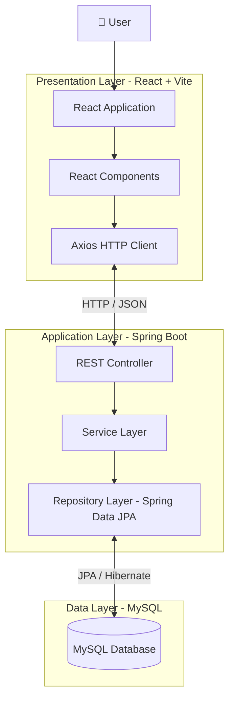

# 💰 SpendWise – Smart Personal Expense Tracker

<p align="center">
  
</p>

<h3 align="center">Track Smarter. Understand Better. Spend Better.</h3>

<p align="center">
  A modern full-stack web application for managing personal income, expenses, and financial activities.
</p>

<p align="center">
  
  
  
  
  
</p>

<p align="center">
  <a href="#-overview">Overview</a> •
  <a href="#-features">Features</a> •
  <a href="#-technology-stack">Tech Stack</a> •
  <a href="#-architecture">Architecture</a> •
  <a href="#-installation--setup">Installation</a> •
  <a href="#-api-documentation">API</a>
</p>

---

## 📌 Overview

**SpendWise – Smart Personal Expense Tracker** is a full-stack web application developed to make everyday financial management easier, smarter, and more organized.

The application provides a centralized platform where users can record income and expenses, manage financial transactions, monitor spending activities, and understand their financial habits.

Built using **React.js, Java 21, Spring Boot, REST APIs, and MySQL**, SpendWise demonstrates the integration of modern frontend and backend technologies in a practical real-world application.

### 🎯 Project Objectives

- Simplify daily income and expense tracking.
- Maintain organized financial transaction records.
- Provide a centralized financial dashboard.
- Analyze monthly income and expenses.
- Identify unusually high expenses.
- Monitor recurring payment information.
- Generate financial summaries and reports.

---

## ✨ Features

| Feature | Description |
|---|---|
| 📊 Dashboard | Overview of income, expenses, and available balance. |
| 💵 Income Management | Record and manage income transactions. |
| 💳 Expense Management | Add, edit, and delete expense records. |
| 📅 Daily Expenses | View transactions based on dates. |
| 🗓️ Monthly Expenses | Analyze monthly spending activities. |
| 📈 Analytics | Visualize financial information through charts. |
| 🚨 High Expense Alerts | Highlight expenses exceeding configured thresholds. |
| ⚠️ High-Value Payments | Review transactions involving unusually high amounts. |
| 🔁 Recurring Schedule | View repeated expense patterns and schedules. |
| 📄 Financial Reports | Prepare printable financial summaries and PDF-ready reports. |

> **Note:** High-expense and high-value payment indicators are rule-based review features, not verified bank fraud detection. Recurring payment information is intended for tracking and does not automatically process payments.

---

## 🛠️ Technology Stack

SpendWise uses separate development environments for frontend and backend development.

### 🎨 Frontend Technologies

| Technology | Purpose |
|---|---|
| React.js | Component-based user interface |
| JavaScript | Frontend application logic |
| HTML5 | Webpage structure |
| CSS3 | Styling and responsive layouts |
| Vite | Frontend development server |
| Axios | HTTP communication with backend APIs |

### ⚙️ Backend Technologies

| Technology | Purpose |
|---|---|
| Java 21 | Backend programming language |
| Spring Boot | Backend application framework |
| Spring Data JPA | Database access and persistence |
| REST APIs | Frontend-backend communication |
| Maven | Dependency and build management |
| Hibernate | Object-relational mapping |

### 🗄️ Database

| Technology | Purpose |
|---|---|
| MySQL 8+ | Relational database |
| Hibernate | Database object mapping |

### 💻 Development Tools

| Tool | Purpose |
|---|---|
| Visual Studio Code | React frontend development |
| Eclipse IDE | Java and Spring Boot development |
| Postman | REST API testing |
| Git | Version control |
| GitHub | Source code hosting |

---
## 👨‍💻 Tool Icon

<p align="center">
  <a href="https://react.dev/">
    
  </a>
  <a href="https://developer.mozilla.org/en-US/docs/Web/JavaScript">
    
  </a>
  <a href="https://developer.mozilla.org/en-US/docs/Web/HTML">
    
  </a>
  <a href="https://developer.mozilla.org/en-US/docs/Web/CSS">
    
  </a>
  <a href="https://vite.dev/">
    
  </a>
</p>

<p align="center">
  <a href="https://www.java.com/">
    
  </a>
  <a href="https://spring.io/projects/spring-boot">
    
  </a>
  <a href="https://maven.apache.org/">
    
  </a>
</p>

<p align="center">
  <a href="https://www.mysql.com/">
    
  </a>
</p>

<p align="center">
  <a href="https://code.visualstudio.com/">
    
  </a>
  <a href="https://www.eclipse.org/">
    
  </a>
  <a href="https://www.postman.com/">
    
  </a>
  <a href="https://git-scm.com/">
    
  </a>
  <a href="https://github.com/">
    
  </a>
</p>


---

## 🏗️ System Architecture

SpendWise follows a three-tier architecture that separates the presentation layer, application logic, and database.

### Architecture Diagram



### 🔄 How the Application Works

1. The user interacts with the React frontend.
2. Axios sends HTTP requests to Spring Boot REST APIs.
3. REST controllers receive incoming requests.
4. The service layer processes application logic.
5. Spring Data JPA communicates with MySQL through repositories.
6. The backend returns responses to the frontend.
7. React updates the interface with the latest information.

### 🌐 Local Development Environment

| Component | URL / Port |
|---|---|
| React Frontend | `http://localhost:5173` |
| Spring Boot Backend | `http://localhost:8080` |
| MySQL Database | `localhost:3306` |

---

## 📂 Project Structure

```text
SpendWise/
│
├── backend/
│   ├── src/
│   │   └── main/
│   │       ├── java/
│   │       │   └── com/expense/tracker/
│   │       │       ├── controller/
│   │       │       │   └── ExpenseController.java
│   │       │       ├── entity/
│   │       │       │   └── Expense.java
│   │       │       ├── repository/
│   │       │       │   └── ExpenseRepository.java
│   │       │       ├── service/
│   │       │       │   └── ExpenseService.java
│   │       │       └── ExpenseTrackerApplication.java
│   │       │
│   │       └── resources/
│   │           └── application.properties
│   │
│   └── pom.xml
│
├── frontend/
│   ├── public/
│   ├── src/
│   │   ├── components/
│   │   ├── pages/
│   │   ├── services/
│   │   └── App.jsx
│   │
│   ├── index.html
│   ├── package.json
│   └── vite.config.js
│
├── sqldb/
│   └── schema.sql
│
├── .gitignore
└── README.md
```

---

## ⚙️ Installation & Setup

Follow these instructions to download, configure, and run SpendWise locally.

<details>
<summary><strong>📋 Step 1 – System Requirements</strong></summary>

Install the following software before starting:

| Software | Required Version |
|---|---|
| Java JDK | 21 |
| Maven | 3.8+ or Eclipse embedded Maven |
| Node.js | 20+ |
| npm | Included with Node.js |
| MySQL | 8.0+ |
| Eclipse IDE | Spring Boot development |
| Visual Studio Code | React development |

Check installed versions:

```bash
java -version
node -v
npm -v
mvn -version
```

</details>

<details>
<summary><strong>📥 Step 2 – Clone the Repository</strong></summary>

Open PowerShell or the VS Code terminal.

```bash
git clone https://github.com/aadeshkhamkar/SpendWise.git
```

Navigate into the project:

```bash
cd SpendWise
```

</details>

<details>
<summary><strong>🗄️ Step 3 – Configure MySQL Database</strong></summary>

Open MySQL Workbench or MySQL Command Line.

Execute the SQL schema:

```sql
SOURCE /path/to/SpendWise/sqldb/schema.sql;
```

The backend expects:

| Configuration | Value |
|---|---|
| Database | `expense_tracker` |
| Username | `root` |
| Password | Your local MySQL password |
| Port | `3306` |

Open the backend configuration file:

```text
backend/src/main/resources/application.properties
```

Configure your database connection:

```properties
spring.datasource.url=jdbc:mysql://localhost:3306/expense_tracker
spring.datasource.username=root
spring.datasource.password=YOUR_MYSQL_PASSWORD
```

Replace `YOUR_MYSQL_PASSWORD` with your local MySQL password.

**Security:** Never upload real database credentials, passwords, or API keys to a public GitHub repository.

</details>

<details>
<summary><strong>☕ Step 4 – Run Spring Boot Backend in Eclipse</strong></summary>

1. Open Eclipse IDE.
2. Select **File → Import**.
3. Select **Maven → Existing Maven Projects**.
4. Browse to the SpendWise `backend` directory.
5. Click Finish.
6. Wait for Maven dependencies to download.
7. Open `ExpenseTrackerApplication.java`.
8. Right-click the file.
9. Select **Run As → Spring Boot App**.

Backend URL:

```text
http://localhost:8080
```

Test the expense endpoint:

```http
GET http://localhost:8080/api/expenses
```

</details>

<details>
<summary><strong>⚛️ Step 5 – Run React Frontend in VS Code</strong></summary>

Open the `frontend` folder in Visual Studio Code.

Open the integrated terminal and install dependencies:

```bash
npm install
```

Start the development server:

```bash
npm run dev
```

Open the URL displayed by Vite:

```text
http://localhost:5173
```

</details>

<details>
<summary><strong>▶️ Step 6 – Run the Complete Application</strong></summary>

Keep all three services running:

| Service | Development Environment | Port |
|---|---|---|
| Frontend | VS Code / Vite | 5173 |
| Backend | Eclipse / Spring Boot | 8080 |
| Database | MySQL | 3306 |

The frontend communicates with the backend through Axios and REST APIs, while Spring Boot communicates with MySQL.

</details>

---

## 🔌 API Documentation

The backend provides REST endpoints for managing income and expense transactions.

**Base URL:**

```text
http://localhost:8080/api
```

### Available API Endpoints

| HTTP Method | Endpoint | Description |
|---|---|---|
| GET | `/expenses` | Retrieve all transactions |
| GET | `/expenses/{id}` | Retrieve a transaction by ID |
| POST | `/expenses` | Create a new transaction |
| PUT | `/expenses/{id}` | Update an existing transaction |
| DELETE | `/expenses/{id}` | Delete a transaction |

### 📝 Create a Transaction

**Request:**

```http
POST http://localhost:8080/api/expenses
Content-Type: application/json
```

**Request Body:**

```json
{
  "title": "Monthly Salary",
  "amount": 25000,
  "category": "Salary",
  "type": "INCOME",
  "date": "2026-11-17",
  "description": "November salary"
}
```

### Transaction Types

| Type | Description |
|---|---|
| `INCOME` | Money received |
| `EXPENSE` | Money spent |

### Retrieve All Transactions

```http
GET http://localhost:8080/api/expenses
```

### Retrieve a Specific Transaction

```http
GET http://localhost:8080/api/expenses/1
```

### Update a Transaction

```http
PUT http://localhost:8080/api/expenses/1
```

### Delete a Transaction

```http
DELETE http://localhost:8080/api/expenses/1
```

Use Postman to test API endpoints and inspect their responses.

> **Authentication note:** The API documentation above covers the transaction endpoints supplied for this project. Do not assume login/signup endpoints are available unless they are implemented in the backend.

---

## 🗄️ Database Design

SpendWise uses MySQL as its relational database.

**Database Name:**

```text
expense_tracker
```

| Table | Purpose |
|---|---|
| `expenses` | Stores income and expense transaction records |
| `app_users` | User account information, if included in the actual database schema |

### Hibernate Configuration

```properties
spring.jpa.hibernate.ddl-auto=update
```

Hibernate can automatically create or update mapped tables based on the entity classes.

SQL schema file:

```text
sqldb/schema.sql
```

---

## 🧪 Software Testing

Testing helps verify the correctness of the application and its integration.

| Testing Type | Purpose |
|---|---|
| API Testing | Verify REST API requests and responses |
| Functional Testing | Check transaction operations |
| Integration Testing | Verify React, Spring Boot, and MySQL communication |
| Validation Testing | Check transaction inputs and data formats |
| UI Testing | Verify application pages and user interactions |

**Testing Tool:** Postman

Actual test results and screenshots can be added after testing the application.

---

## 🖥️ Application Screenshots

Visual screenshots help developers and visitors understand how SpendWise works.

Create this directory in your repository:

```text
docs/
└── screenshots/
    ├── landing-page.png
    ├── dashboard.png
    ├── add-transaction.png
    ├── analytics.png
    ├── transactions.png
    └── reports.png
```

Add your actual application screenshots below.

### 🏠 Landing Page


### 📊 Dashboard


### 💳 Transaction Management


### 📈 Analytics


### 📄 Financial Reports


> Replace the screenshot placeholders with actual screenshots before publishing. GitHub will display the images once the files are added to the repository.

---

## 🚀 Future Enhancements

Possible improvements for future versions:

- JWT-based authentication and authorization.
- User-specific transaction access.
- Advanced spending analytics.
- Machine learning-based expense predictions.
- Automated recurring expense reminders.
- Budget planning and savings goals.
- CSV and Excel report exports.
- Cloud deployment.
- Mobile application support.

---

## 🛠️ Troubleshooting

<details>
<summary><strong>❌ MySQL Connection Error</strong></summary>

Possible solutions:

- Check whether MySQL Server is running.
- Verify the database name.
- Check your MySQL username and password.
- Confirm that port `3306` is available.
- Check the JDBC URL in `application.properties`.

</details>

<details>
<summary><strong>❌ Spring Boot Backend Not Starting</strong></summary>

Possible solutions:

- Check your Java version using `java -version`.
- Make sure Java 21 is configured in Eclipse.
- Update Maven dependencies.
- Check the Eclipse console for errors.
- Verify that port `8080` is available.

</details>

<details>
<summary><strong>❌ Frontend Dependency Installation Error</strong></summary>

Run:

```bash
npm install
```

If dependency conflicts occur, check the Vite and React plugin versions in `package.json`. Make sure their peer dependencies are compatible.

Avoid immediately using `--force` or `--legacy-peer-deps`.

</details>

<details>
<summary><strong>❌ Frontend Cannot Connect to Backend</strong></summary>

Possible solutions:

- Make sure Spring Boot is running.
- Verify the backend URL.
- Check Axios API configuration.
- Confirm that CORS allows `http://localhost:5173`.
- Inspect the browser developer console.

</details>

<details>
<summary><strong>❌ Port Already in Use</strong></summary>

Check whether another application is using ports `8080` or `5173`.

Stop the conflicting process or configure an available port.

</details>

---

## 🤝 Contributing

Contributions, suggestions, and improvements are welcome!

To contribute:

1. Fork this repository.
2. Create a new branch.
3. Make your changes.
4. Test your changes.
5. Submit a Pull Request.

```bash
git checkout -b feature/your-feature
git add .
git commit -m "Add your feature"
git push origin feature/your-feature
```

---

## 📚 References

- [React Documentation](https://react.dev/)
- [Spring Boot Documentation](https://docs.spring.io/spring-boot/)
- [Java Documentation](https://docs.oracle.com/en/java/)
- [MySQL Documentation](https://dev.mysql.com/doc/)
- [Axios Documentation](https://axios-http.com/docs/intro)
- [Vite Documentation](https://vite.dev/guide/)
- [Git Documentation](https://git-scm.com/doc)

---

## 👨‍💻 Project Information

| Detail | Information |
|---|---|
| Project Name | SpendWise – Smart Personal Expense Tracker |
| Developed By | Aadesh Khamkar |
| Institution | Dr. D. Y. Patil Institute of Engineering, Management and Research, Akurdi, Pune |
| Training Organization | ExcelR |
| Domain | Full Stack Web Development |
| Frontend | React.js |
| Backend | Java 21 / Spring Boot |
| Database | MySQL |

## 📬 Contact

**Aadesh Khamkar**

- GitHub: [@aadeshkhamkar](https://github.com/aadeshkhamkar)
- Portfolio: [aadeshkhamkar.netlify.app](https://aadeshkhamkar.vercel.app/)

**Repository:** [SpendWise – GitHub](https://github.com/aadeshkhamkar/SpendWise)

---

<p align="center">
  
</p>

<h3 align="center">💰 SpendWise – Track Smarter. Spend Better.</h3>

<p align="center">
  Made with ❤️ by <strong>Aadesh Khamkar</strong>
</p>
